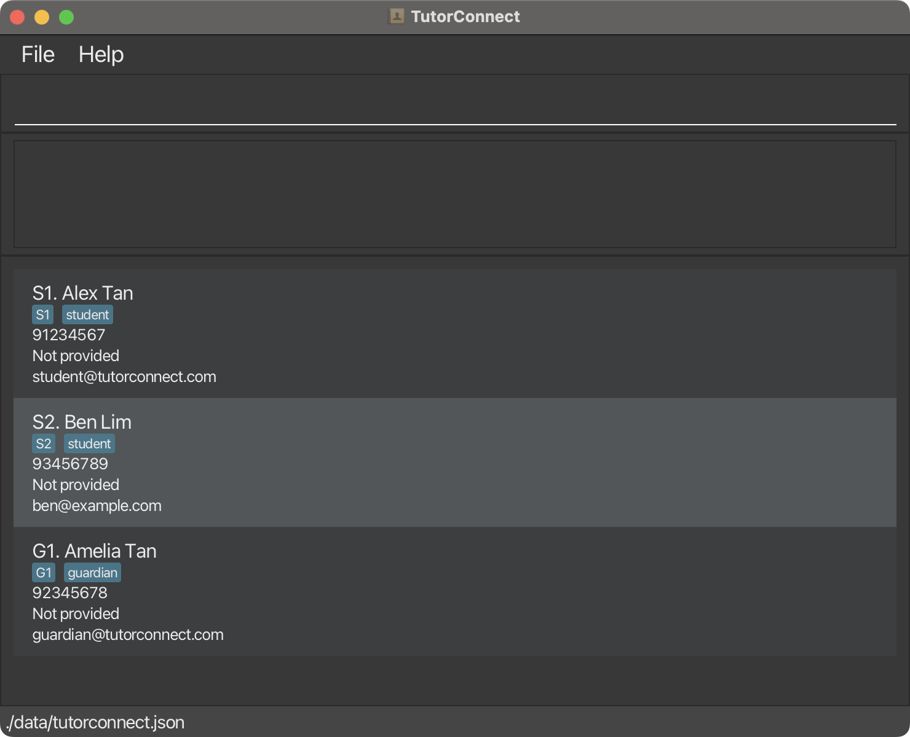

**TutorConnect is a desktop application for independent private tutors who teach a small recurring group of secondary-school and junior-college students.** It helps tutors keep student and guardian contact details in one place, with stable IDs (`S1`, `G1`, …) and guardian-student links, so they can find and update information quickly from the command line.

* To start using TutorConnect, see the [_Quick Start_ section of the **User Guide**](UserGuide.html#quick-start).
* To learn about the codebase, see the [**Developer Guide**](DeveloperGuide.html).

**Acknowledgements**

* TutorConnect is based on the [AddressBook-Level3 project](https://se-education.org/addressbook-level3/).
* Libraries used: [JavaFX](https://openjfx.io/), [Jackson](https://github.com/FasterXML/jackson), [JUnit5](https://github.com/junit-team/junit5)
